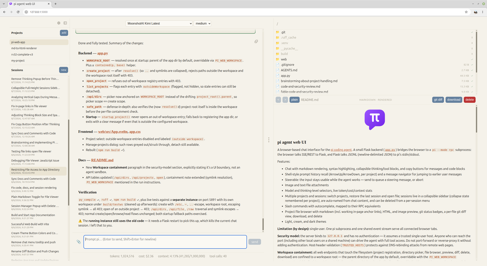

<p align="center">
  
</p>

<p align="center">
  
</p>

# pi agent web UI

A browser-based chat interface for the
[pi coding agent](https://github.com/earendil-works/pi).

Run the server next to your project directories, open it in any browser
on your network, and drive pi from there — chat with markdown rendering
and syntax highlighting, browse and edit project files, switch between
projects and sessions, and watch the agent's tool output stream in live.

```
Browser  <--SSE / REST-->  Flask (app.py)  <--JSONL stdin/stdout-->  pi --mode rpc
```

A small Flask backend ([`app.py`](app.py)) bridges the browser to a
`pi --mode rpc` subprocess: the browser talks SSE/REST to Flask, and Flask
talks JSONL (newline-delimited JSON) to pi's stdin/stdout. The frontend is
a Svelte 5 + Vite single-page app in [`web/`](web/) (see
[web/README.md](web/README.md) for frontend notes), built into
`web/dist/`, which Flask serves.

> **One instance hosts one active project.** A single pi subprocess and a
> shared event stream serve all connected tabs — by design. To run agents
> in several projects at once, start additional instances on other ports
> (`PORT=5001 make serve`). Instances are fully independent: the project
> registry is keyed by port (`projects-<port>.json` next to
> [`app.py`](app.py)), so they share no state. Never register the same
> project on two instances — two agents in one worktree will step on
> each other.

## Quick start

Prerequisites: **Python 3**, **Node.js/npm**, and **`pi` on `PATH`**.

```sh
# 1. Backend dependencies (once)
python3 -m venv .venv && source .venv/bin/activate
python -m pip install -r requirements.txt

# 2. Build the frontend (Flask serves only the built web/dist/)
cd web && npm install && npm run build && cd ..

# 3. Run
python app.py
```

Then open **http://localhost:5000** (or the machine's LAN address — see
[security](#security) below before exposing it). Use the **Projects**
sidebar to register or create a project directory, then start chatting.

### Configuration

All settings can be passed as environment variables or kept in a local,
gitignored `.env` (copy from [`.env.example`](.env.example); real
environment variables take precedence):

| Variable | Default | Purpose |
|---|---|---|
| `HOST` | primary LAN IP + loopback | `127.0.0.1` restricts to loopback, `0.0.0.0` opens all interfaces (dangerous — see [security](#security)) |
| `PORT` | `5000` | Also selects the per-instance registry file (`projects-<port>.json`) |
| `PI_WEB_WORKSPACE` | parent of the app dir | Confines projects and the file browser to this directory |
| `PI_WEB_TRUSTED_HOSTS` | — | Extra accepted Host headers, comma-separated (leading dot matches subdomains) |

### Shortcuts

The [Makefile](Makefile) wraps the common workflows:

```sh
make run     # rebuild frontend + start the dev server
make serve  # gunicorn (via gunicorn.conf.py): 1 worker, 64 threads
make dev    # Vite dev server with hot reload (keep app.py running alongside)
make check  # full verification: syntax, lint, tests, frontend build
make audit  # dependency vulnerability scan (needs network + pip-audit)
```

`make serve` runs gunicorn via [`gunicorn.conf.py`](gunicorn.conf.py) —
exactly **one** worker (the pi subprocess and all bridge state are module
globals) with a 64-thread pool. Every open browser tab pins one thread for
its SSE stream, so keep `threads` generous and never raise `workers`.
`PORT=5001 make serve` starts a second, fully independent instance with
its own registry, pi subprocess, and sessions.

## Features

### Chat

- Markdown rendering, syntax highlighting, collapsible
  thinking/tool blocks, copy buttons for messages and code blocks
- **Steerable:** the input stays usable while the agent works — send to
  queue a steering message, or abort
- Image and text-file attachments
- Model and thinking-level selectors, live token/cost/context stats

### Projects and sessions

- Multiple projects: switch between them; create, register, or clone
  (git URL) project directories
- Multiple sessions: sessions live in a collapsible sidebar (collapse
  state remembered per project), are auto-named from chat content, and
  can be deleted from a per-session menu
- The last session and open file are restored on reload
- The projects section grows on hover (up to 80% of the window height)
  when not all entries fit, easing back when the mouse leaves

### Slash commands and shell

- Slash commands with autocomplete, mapped to their RPC equivalents;
  extension commands run inside pi, and their notifications
  (`ctx.ui.notify`, e.g. the output of a local `/git-status` command)
  show up in the chat — multi-line output as a collapsible block
- `!cmd` runs a shell command in the project directory with
  live-streamed output and adds the result to the model context with
  the next prompt; `!!cmd` runs it locally only (the model never sees
  it). Results persist in the session and render after reload
- Shell-style prompt history recall (ArrowUp/ArrowDown, per session)
  and a message navigator for jumping to earlier user messages

### Files

- Project file browser with markdown (incl. working in-page anchor
  links), HTML, and image preview, git status badges, an in-file
  git diff view (full file, changed lines highlighted), download, and
  delete. The browser pane expands on hover (re-measured on directory
  change, max 80% of the window height) and eases back when the mouse
  leaves
- **Text edit mode:** a syntax-highlighted editor (highlighted
  underlay + transparent textarea) with Ctrl+S save, Esc quit, and
  optimistic concurrency against agent-side edits — a save that would
  clobber changes made on disk is rejected with a conflict, and the
  editor offers overwrite / reload / keep editing

### Layout and themes

- Mobile layout (screens ≤ 1024px): one full-screen pane at a time,
  switched via a slide-in menu (Projects, Sessions, Messages, Chat,
  Files; the file viewer is reached by tapping a file in Files), which
  also hosts the model and thinking-level selectors. Selecting a session
  or file jumps to the chat / file viewer automatically
- Light, cream, and dark themes

## Security

Read this before exposing the server beyond loopback. The server has
**no authentication** and assumes a **trusted network**: anyone who can
reach the port (other local users, but also other machines on the LAN)
can drive the agent with full tool access and run arbitrary shell
commands directly (the `/bash` endpoint).

- By default the server binds the machine's **primary LAN IP plus a
  separate loopback listener** (so both `localhost:5000` and the LAN
  address work without listening on *all* interfaces). Set
  `HOST=127.0.0.1` to restrict to loopback; `HOST=0.0.0.0` opens every
  interface. Do **not** port-forward or reverse-proxy the app without
  adding authentication.

### DNS-rebinding and cross-site protection

- **Host-header validation** (`TRUSTED_HOSTS`, overridable via
  `PI_WEB_TRUSTED_HOSTS`): every request's Host header is checked
  dynamically against loopback, localhost, machine hostnames, mDNS
  `.local`, and all active interface/route IPs — protecting against
  DNS-rebinding attacks from remote web pages while staying resilient
  across DHCP address changes and multi-homed setups. Hosts the server
  cannot discover itself (e.g. a systemd-nspawn container addressed by
  its machine name via `nss-mymachines`, resolvable only on the host)
  must be added to `PI_WEB_TRUSTED_HOSTS`, otherwise such requests get
  `400 Bad Request`.
- **Cross-site rejection:** all endpoints additionally reject requests
  that modern browsers mark as `Sec-Fetch-Site: cross-site` (403) — a
  remote page cannot probe the LAN endpoint with ``/`<script>`
  subresource requests. Top-level GET navigations (following a link to
  the app from another site) stay allowed. Non-browser clients (curl,
  pi tooling) don't send the header and are unaffected. Pages on other
  ports of the same host count as `same-site` and are not covered by
  this check.
- **One deliberate exception:** passive subresource loads (``,
  `<link>`, `<script>`, fonts, media) of `/raw/<token>/*` files are
  allowed even when labelled cross-site. The sandboxed HTML-preview
  iframe has an opaque origin, so browsers label everything it
  requests as cross-site — without the exception, relative assets in a
  previewed HTML page could not load. The `<token>` prefix is an
  unguessable per-process secret distributed only to the same-origin
  SPA, so remote pages cannot guess `/raw/` URLs to probe file
  existence or perform XSSI.

### Exfiltration hardening

- **Agent output never auto-loads remote images:** `https:` images in
  chat messages become click-through links (a prompt-injected reply
  could otherwise exfiltrate data through the URL of an image the
  browser fetches on its own). Alternate HTML/SVG subresource loaders
  (`srcset`, `poster`, `<picture>`, `<source>`, `<video>`, `<audio>`,
  `<svg><image>`, `<feImage>`, `<use>`, `<foreignObject>`) are stripped
  by DOMPurify. The markdown file viewer does load `https:` images
  (README badges); `http:` images are blocked everywhere by CSP.

### Response headers

- `Content-Security-Policy: frame-ancestors 'none'` (plus
  `X-Frame-Options: DENY`) on the app page — other pages cannot embed
  it in an iframe and clickjack the UI
- `X-Content-Type-Options: nosniff` and `Referrer-Policy:
  no-referrer` on all responses; `Cache-Control: no-store` on
  API/dynamic responses

### Workspace containment

All web endpoints that touch the filesystem (project registration,
directory picker, file browser, preview, diff, delete, download) are
confined to a **workspace root** — the parent directory of the app by
default, overridable with `PI_WEB_WORKSPACE`. Registry entries outside
the workspace (stale or hand-edited) are flagged in the UI, cannot be
opened, and can only be detached. This is an honest UI boundary, not a
sandbox for the agent: pi itself runs with full user privileges and its
bash tool can read and write anywhere the OS user can.

## Architecture

```
Browser  <--SSE / REST-->  Flask (app.py)  <--JSONL stdin/stdout-->  pi --mode rpc
```

- The Flask app spawns `pi --mode rpc` at startup (in the most recently
  opened project's directory). If the pi process dies unexpectedly, it
  is respawned automatically on the next request and resumes the latest
  session; connected tabs are notified via a `pi_exited` SSE event and
  reconnect on their own. A reader thread parses pi's stdout, routes
  correlated command responses to waiting HTTP handlers (request/response
  correlation via UUIDs), and broadcasts all other events to SSE
  subscribers.
- The frontend is a Svelte 5 + Vite single-page app in [`web/`](web/),
  built into `web/dist/`, which Flask serves at `/`. See
  [web/README.md](web/README.md) for frontend-specific notes.
- Styling is plain CSS with theme variables
  ([`web/src/app.css`](web/src/app.css)); highlight.js themes are scoped
  per app theme so they don't clash.

## Project layout

| Path | Description |
|---|---|
| [`app.py`](app.py) | Flask backend: pi subprocess management, RPC bridging, REST/SSE API, static hosting |
| [`web/src/App.svelte`](web/src/App.svelte) | Entire SPA: chat, toolbar, sessions, slash commands, file browser/viewer |
| [`web/src/app.css`](web/src/app.css) | All styles; light/cream/dark themes via CSS custom properties |
| [`web/src/main.js`](web/src/main.js) | Svelte entry point (mounts `App`) |
| [`web/index.html`](web/index.html) | Vite HTML entry |
| [`web/vite.config.js`](web/vite.config.js) | Vite config; dev-server proxy for the backend endpoints |
| [`web/jsconfig.json`](web/jsconfig.json) | JS type-checking config (checkJs) for the frontend |
| [`web/package.json`](web/package.json) | Frontend dependencies (svelte, vite, marked, dompurify, highlight.js, github-slugger) |
| [`gunicorn.conf.py`](gunicorn.conf.py) | Gunicorn config for `make serve` (1 worker, 64 threads, honors `HOST`/`PORT`/`.env` and loopback dual-bind) |
| [`tests/test_app.py`](tests/test_app.py) | Backend unit and security test suite (mocked `PiProcess`, hermetic workspace) |
| [`Makefile`](Makefile) | Build/run/test shortcuts (`build`, `run`, `dev`, `serve`, `test`, `check`, `audit`) |
| [`doc/theme-preview.md`](doc/theme-preview.md) | Demo document for comparing the themes in the file viewer |
| [`LICENSE`](LICENSE) | License |
| [`requirements.txt`](requirements.txt) | Pinned Python dependencies (Flask, gunicorn, python-dotenv) |
| [`requirements-dev.txt`](requirements-dev.txt) | Development-only tools (pip-audit for `make audit`) |
| [`.env.example`](.env.example) | Tracked template for machine-local settings (copied to gitignored `.env`) |
| [`web/public/`](web/public/) | Static assets (favicon, logo, icons) copied into `dist/` |
| [`AGENTS.md`](AGENTS.md) | Project conventions for coding agents |

Generated content (not committed): `web/dist/`, `web/node_modules/`,
`.venv/`, `build/`, `__pycache__/`, `projects-<port>.json` (the per-port
project registry).

## Development

```sh
cd web && npm run dev   # Vite dev server with live reload; proxies
                        # API calls to app.py on 127.0.0.1:5000
```

Keep `python app.py` running alongside the dev server.

Two things to know:

- `web/dist/` is gitignored, so Flask only serves what was last built.
  Re-run `npm run build` in [`web/`](web/) after every change under
  `web/src/` (or use `npm run dev` for live reload).
- Restarting [`app.py`](app.py) kills the pi subprocess and the chat
  session it hosts. Switching projects does the same by design (the UI
  warns first if a run is active); other open tabs get a
  `project_switched` event and reconnect. pi also caches slash commands
  (prompt templates, skills, extension commands) at subprocess startup,
  so newly added templates only appear after a restart or project
  switch.

### Testing and verification

- `make test` — backend unit and security test suite
  ([`tests/test_app.py`](tests/test_app.py), mocked `PiProcess`)
- `make check` — full static verification: `py_compile` + `ruff` +
  unit tests + frontend build
- `make audit` — dependency vulnerability scan (`pip-audit` on the
  pinned backend deps, full `npm audit` on the frontend). Needs network
  access and pip-audit in the venv:
  `.venv/bin/python -m pip install -r requirements-dev.txt`

## Backend API reference

### Chat and agent control

| Endpoint | Method | Purpose |
|---|---|---|
| `/events` | GET (SSE) | Stream of pi events (5 s keepalive comments; the stream ends once its pi process is gone — clients reconnect on `project_switched`/`pi_exited`) |
| `/prompt` | POST | Send a prompt; optional `images` and `streamingBehavior` |
| `/abort` | POST | Abort the current run |
| `/bash` | POST | Run a shell command in the project cwd; async — returns the command id, streamed output arrives as `bash_execution_update` SSE events, the result as a synthetic `bash_execution_end` event |
| `/abort_bash` | POST | Abort running `/bash` commands (pi cancels all of them) |
| `/new_session` | POST | Start a new session |
| `/messages` | GET | Current session message history |
| `/state` | GET | Agent state (model, thinking level, session file, ...) |
| `/stats` | GET | Session stats (tokens, cost, context usage, tool calls) |

### Model configuration

| Endpoint | Method | Purpose |
|---|---|---|
| `/models` | GET | Available models |
| `/set_model` | POST | Switch model (`provider`, `modelId`) |
| `/thinking_levels` | GET | Available thinking levels |
| `/set_thinking` | POST | Set thinking level |

### Sessions and slash commands

| Endpoint | Method | Purpose |
|---|---|---|
| `/sessions` | GET | List recent session files (newest first, max 50) |
| `/switch_session` | POST | Switch to a session file (path confined to the session dir) |
| `/commands` | GET | Slash commands invocable via prompt (pi `get_commands`) |
| `/compact` | POST | Compact context; optional `customInstructions` |
| `/set_session_name` | POST | Set session display name |
| `/delete_sessions` | POST | Delete session files from disk (paths confined to the session dir; deleting the active session is allowed) |
| `/api/auto_name` | POST | Name the session from its content via a one-shot pi call (no-op if already named or too little content; `force: true` regenerates) |
| `/export_html` | POST | Export session to an HTML file |
| `/ui-response` | POST | Relay extension UI dialog responses to pi (dialogs only; fire-and-forget requests like `notify` get no response) |

### Projects

| Endpoint | Method | Purpose |
|---|---|---|
| `/api/projects` | GET | List registered projects (marks the current one; flags entries outside the workspace) |
| `/api/dirs?path=` | GET | Directory picker for the new-project dialog: directories only, confined to the workspace root |
| `/api/projects` | POST | Register an existing directory or create a new one (`path`, optional `gitInit`), or clone a repo into the workspace (`gitUrl`, optional `folder`; the folder defaults to the repo name from the URL); the project name is the leaf directory name; paths must lie inside the workspace (403 otherwise) |
| `/api/projects/<id>/open` | POST | Switch the active project: respawn pi with the project dir as cwd (403 if the project is outside the workspace) |
| `/api/projects/<id>/detach` | POST | Remove a project from the registry (directory stays on disk; detaching the current project is allowed — pi keeps running there, the UI enters a "no project" state and other tabs get `project_detached`) |
| `/api/projects/<id>/last-file` | POST | Remember the project's open viewer file (`lastFile`) |

### File browser and static hosting

| Endpoint | Method | Purpose |
|---|---|---|
| `/api/list?path=` | GET | List a directory under the project root |
| `/api/file?path=` | GET | Preview a file (UTF-8, max 512 KB) |
| `/api/diff?path=` | GET | Full-context git diff (`-U…`) for one file (worktree vs HEAD; untracked vs /dev/null), rendered by the frontend as an in-file diff with changed lines highlighted |
| `/api/file/delete` | POST | Delete a file (or directory tree) under the project root |
| `/api/file/create` | POST | Create an empty file or directory under the project root (409 if it already exists) |
| `/api/file/save` | POST | Save file content from edit mode (atomic write, permission-preserving; rejects with `conflict: true` when the disk content no longer matches the client's `base`, unless `force`) |
| `/raw/<token>/<path>` | GET | Serve a file inline (image/HTML preview; per-process token + nosniff + CSP sandbox) |
| `/download/<path>` | GET | Download a file |
| `/` | GET | Serve the built SPA from `web/dist/` |

Paths for `/api/list`, `/api/file`, `/api/diff`, `/api/file/delete`,
`/api/file/create`, `/api/file/save`, `/raw/*`, and `/download/*` are
confined to the current project's root, which itself must lie inside the
workspace root (traversal attempts get 403; symlinks are resolved before
the containment check). POST endpoints require an
`X-Requested-With: XMLHttpRequest` header (CSRF protection, 403
otherwise), and every endpoint rejects requests labelled
`Sec-Fetch-Site: cross-site` by the browser (403), except top-level GET
navigations. POST endpoints validate their JSON bodies and return 400 on
missing fields; RPC calls time out after 30 s with a
`{"success": false, "error": "timeout"}` response.